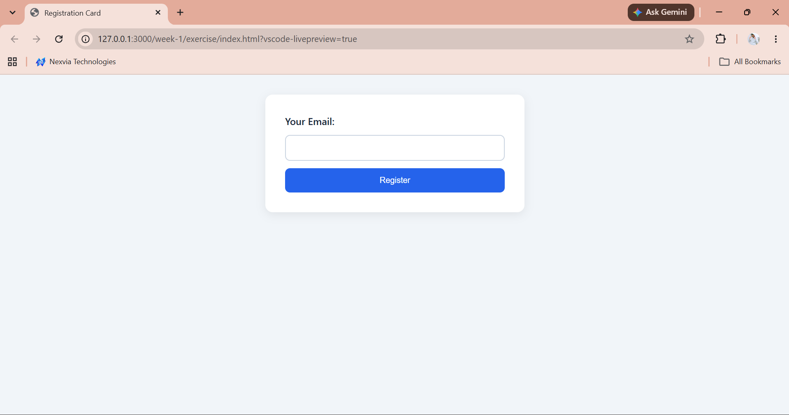
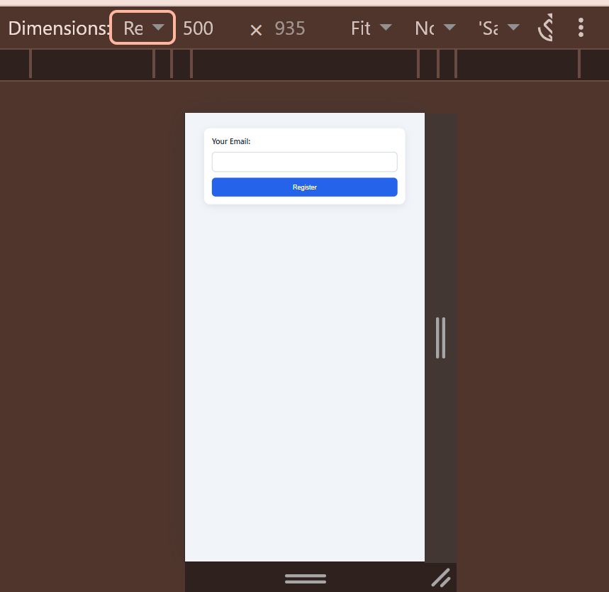

# Week 1: Web Foundations (HTML + CSS & Responsive Design)

## Exercise: Accessible Responsive Registration Card

Requirements:
- Label linked to email input using matching `for` and `id`
- `box-sizing: border-box` on all elements
- Flexbox column layout for the form
- Media query for screens under 600px

### Desktop

### Mobile

### Label click focuses the input

## What I learned
- Browser flow: URL, DNS, TCP/TLS handshake, HTTP GET, server response, DOM/CSSOM render
- Why labels need `for` and `id`, why `border-box` and the viewport meta tag matter