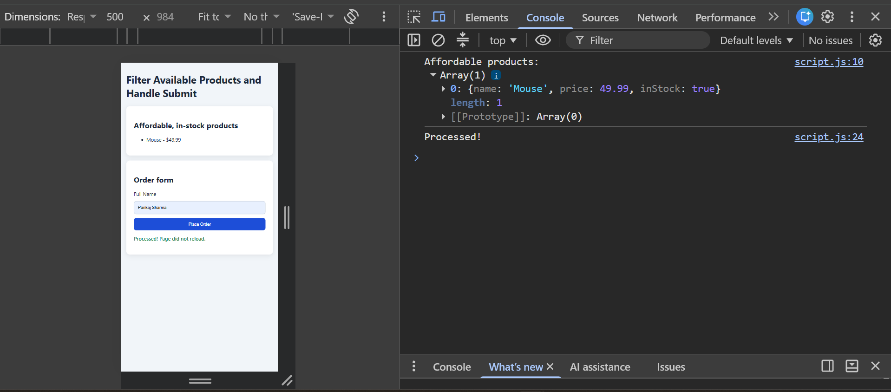

# Week 2: Event Handling

## Exercise: Filter Available Products and Handle Submit

Requirements:
- Filter products where `price <= 100` and `inStock === true` using `filter()`
- Stop the browser's default form reload using `event.preventDefault()`

### Filter output

### Submit handled without page reload

## What I learned
- `filter()` returns a new array and does not change the original
- Use `===` instead of `==` to avoid type coercion bugs
- `preventDefault()` stops the form from reloading the page