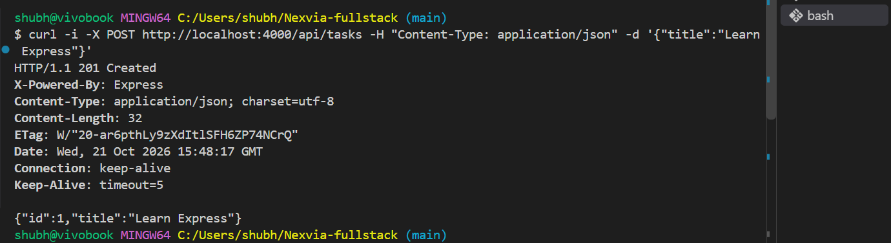
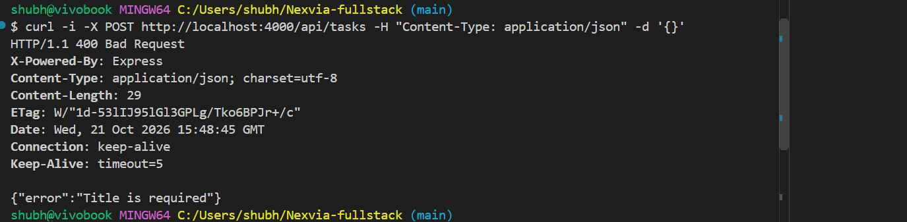
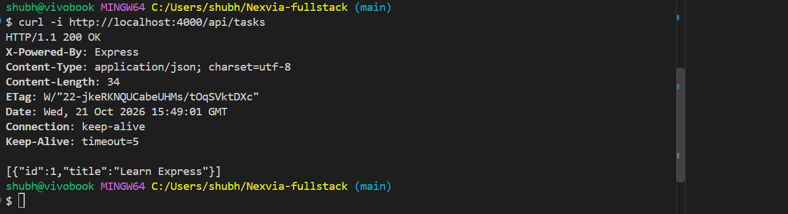

# Week 3: Backend Architecture (Node.js + Express)

## Exercise: Express POST /api/tasks with 400 and 201 status codes

Requirements:
- Return `400 Bad Request` with an error message if `req.body.title` is missing
- Otherwise add the task to the array and return `201 Created` with the new task

### Valid request returns 201

### Missing title returns 400

### List of tasks

## How to run
cd week-3/exercise
npm install
node server.js

## What I learned
- `app.use(express.json())` is needed to read JSON request bodies
- Use correct status codes: 400 for bad input, 201 for created
- Never concatenate user input into SQL; use parameterized queries
- Always validate on the server, not only in the HTML form