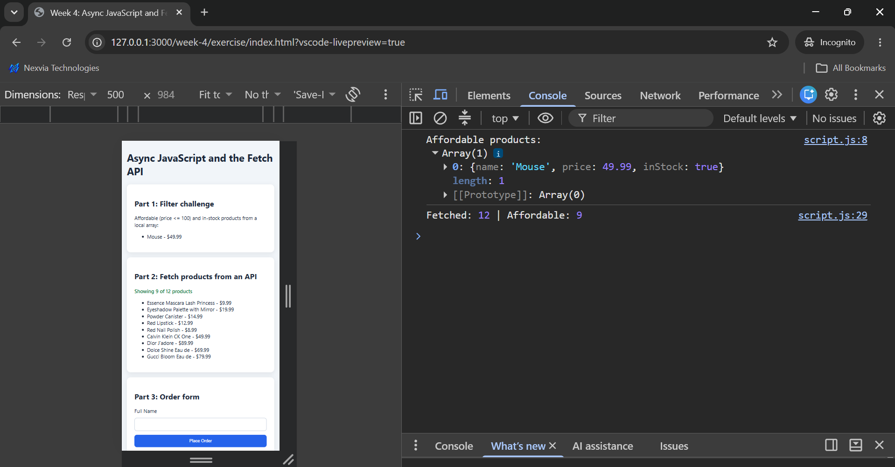
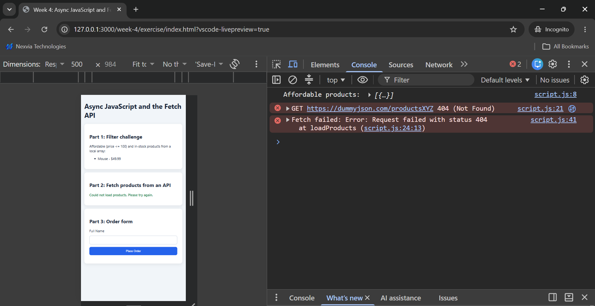
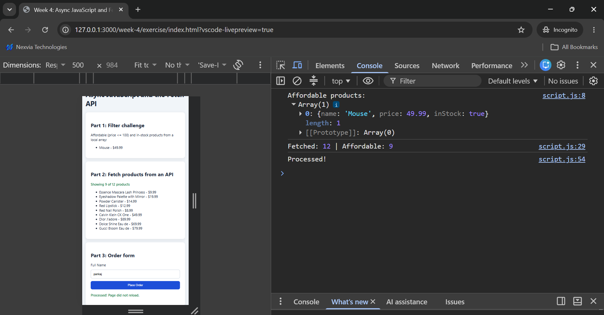

# Week 4: Asynchronous JavaScript and the Fetch API

## Exercise

1. Filter products with `price <= 100` and `inStock === true` using `filter()`
2. Prevent the default form reload using `event.preventDefault()`
3. Extra: fetch products from an API using `async/await` with loading and error states

### Filter and fetch output

### Error state (wrong URL returns 404)

### Submit handled without page reload

## What I learned

- JavaScript is single-threaded; the event loop handles slow tasks like network requests
- `fetch` does not reject on 404 or 500, so check `response.ok`
- Wrap `await` calls in `try/catch` to avoid uncaught promise rejections
- Use `===`, `preventDefault()` on form submit, and non-mutating array methods
