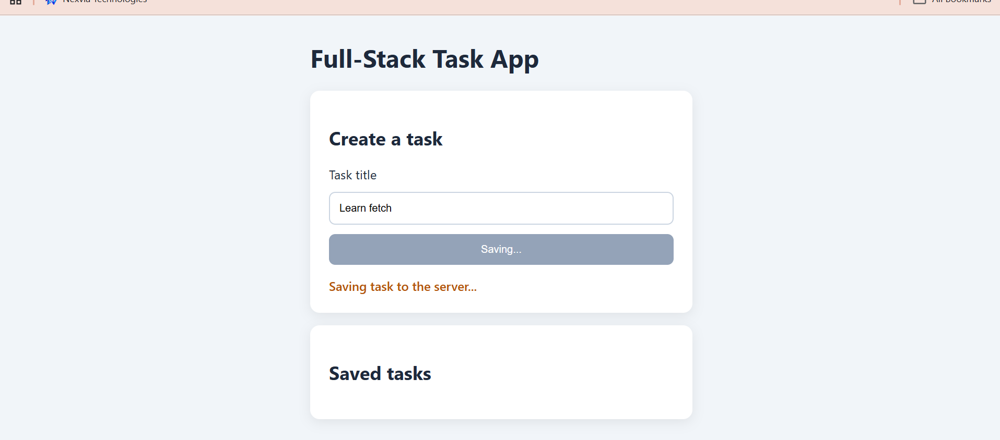
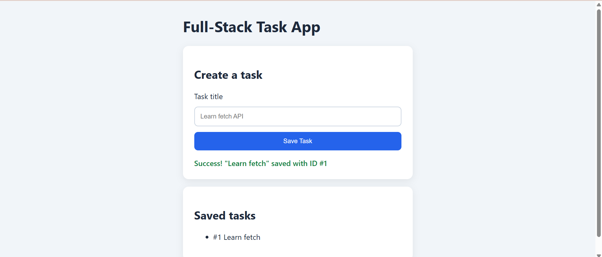
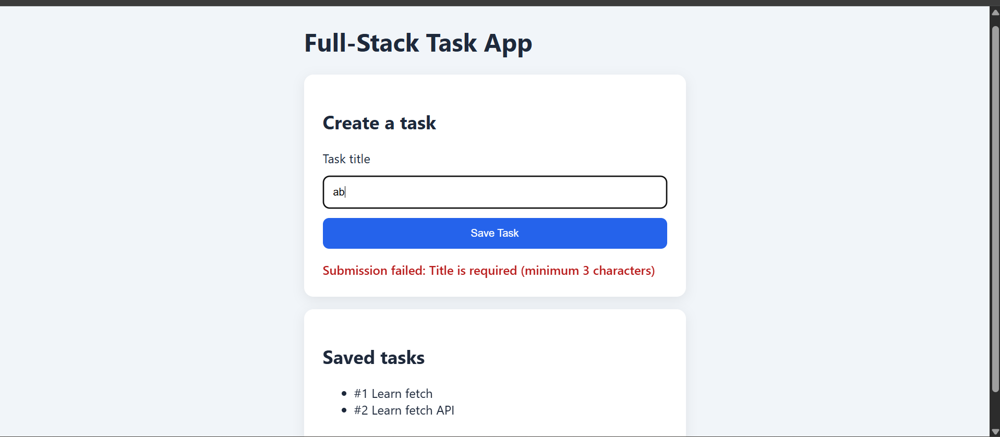

# Week 5: Full-Stack Integration (Fetch + Express)

## Exercise: Async fetch with response.ok and button toggle

Requirements:

- Disable the submit button before the fetch call
- Inspect `res.ok` and throw an error if false
- Always re-enable the button in a `finally` block

I extended it into a small full-stack app: an Express server with validation (400 / 201) serving a frontend that handles loading, success and error states.

### Loading state



### Success state



### Error state (400 from server)



## How to run

```bash
cd week-5/exercise
npm install
node server.js
# open http://localhost:4000
```

## What I learned

- `fetch()` only rejects on network failure, so check `res.ok`
- Use relative URLs like `/api/tasks`, not hardcoded localhost
- Disable the button while a request is in flight and re-enable it in `finally`
- Keep secrets in `.env` and add `.env` to `.gitignore`
